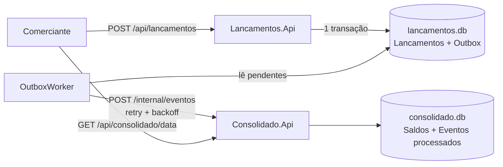

# Fluxo de Caixa

Solução para controle de fluxo de caixa de um comerciante: registro de lançamentos (créditos e débitos) e consulta do saldo diário consolidado.

São dois serviços independentes em .NET 10 / C#:

| Serviço | Porta | Responsabilidade |
|---|---|---|
| **Lancamentos.Api** | 5101 | Registrar e listar lançamentos. Emite o token de acesso (apenas para uso local). |
| **Consolidado.Api** | 5102 | Manter e consultar o saldo diário consolidado. |

O requisito central — *o controle de lançamentos não pode parar se o consolidado cair* — é resolvido com o **Transactional Outbox**: o lançamento e o evento são gravados na mesma transação local, e um worker entrega o evento ao consolidado em segundo plano, com retry e backoff. Se o consolidado estiver fora, os eventos ficam na fila (tabela) e são entregues quando ele voltar.



**Arquitetura adotada:** microsserviços enxutos (2 serviços), orientados a eventos, com CQRS entre escrita e leitura, banco por serviço e arquitetura em camadas (API → Application → Domain → Infrastructure) dentro de cada um. Resumo na [seção 0 de docs/arquitetura.md](docs/arquitetura.md).

A justificativa das decisões, os diagramas completos e a evolução prevista estão em [docs/](docs/):

- [docs/arquitetura.md](docs/arquitetura.md) — visão geral, domínios, fluxos, requisitos não funcionais, segurança
- [docs/adr/](docs/adr) — registros das decisões arquiteturais
- [docs/evolucao.md](docs/evolucao.md) — o que eu faria com mais tempo

## Como rodar

Pré-requisito: [.NET SDK 10](https://dotnet.microsoft.com/download). Não precisa de Docker nem de banco instalado (usa SQLite em arquivo).

```powershell
git clone <url-do-repositorio>
cd FluxoCaixa

# sobe os dois serviços (cada um numa janela)
.\scripts\run-local.ps1
```

Ou manualmente, em dois terminais:

```bash
dotnet run --project src/Consolidado.Api
dotnet run --project src/Lancamentos.Api
```

Com os dois no ar, o script de demonstração faz login, cria alguns lançamentos e mostra o consolidado:

```powershell
.\scripts\demo.ps1
```

Os bancos (`lancamentos.db` e `consolidado.db`) são criados sozinhos na primeira execução, dentro da pasta de cada projeto.

### Testando a resiliência

1. Com tudo rodando, feche a janela do **Consolidado**.
2. Continue registrando lançamentos — a API responde `201` normalmente.
3. Suba o Consolidado de novo. Em alguns segundos os eventos pendentes são entregues e o saldo do dia fica correto.

### Usando a API

O arquivo [requests.http](requests.http) tem exemplos prontos (extensão REST Client do VS Code). Em resumo:

```bash
# 1. token (usuário de desenvolvimento: comerciante / senha123)
curl -X POST http://localhost:5101/auth/token -H "Content-Type: application/json" \
     -d '{"usuario":"comerciante","senha":"senha123"}'

# 2. registrar lançamento (tipo: Credito | Debito)
curl -X POST http://localhost:5101/api/lancamentos \
     -H "Authorization: Bearer <token>" -H "Content-Type: application/json" \
     -d '{"tipo":"Credito","valor":250.00,"descricao":"Venda no balcão"}'

# 3. listar lançamentos do dia
curl "http://localhost:5101/api/lancamentos?data=2026-10-26" -H "Authorization: Bearer <token>"

# 4. consolidado do dia
curl http://localhost:5102/api/consolidado/2026-10-26 -H "Authorization: Bearer <token>"
```

| Método | Rota | Serviço | Auth |
|---|---|---|---|
| POST | `/auth/token` | Lancamentos | — |
| POST | `/api/lancamentos` | Lancamentos | JWT |
| GET | `/api/lancamentos?data=` | Lancamentos | JWT |
| GET | `/api/consolidado/{data}` | Consolidado | JWT |
| POST | `/internal/eventos` | Consolidado | API key (uso interno) |
| GET | `/health` | ambos | — |

Se `data` não for informada ao lançar, vale o dia atual no fuso `America/Sao_Paulo` (configurável em `Negocio:FusoHorario`).

## Modelo arquitetural e por quê

**Modelo adotado:** microsserviços enxutos (2 serviços), orientados a eventos, com CQRS entre escrita e leitura, um banco por serviço e arquitetura em camadas dentro de cada serviço.

O ponto de partida é o requisito não funcional do enunciado: *o controle de lançamentos não pode ficar indisponível se o consolidado cair*. Isso pede que os dois sejam unidades independentes, e as demais decisões decorrem disso.

| Decisão | Por quê | Alternativa descartada |
|---|---|---|
| **2 serviços (Lancamentos e Consolidado)** | A falha de um não pode derrubar o outro. A fronteira entre eles é natural: um escreve, o outro lê | **Monolito:** uma falha ou sobrecarga no relatório derrubaria os lançamentos. **Mais serviços** (auth, gateway, relatórios): complexidade operacional sem ganho neste escopo. **Serverless:** serviria ao consolidado, mas prende o projeto a um provedor |
| **Banco por serviço** | Isolamento de falha e evolução independente do schema | Banco compartilhado: a queda do banco derrubaria os dois |
| **CQRS entre os serviços** | Escrita e leitura têm perfis de carga diferentes (poucas escritas × 50 req/s de leitura em pico) e escalam separadamente. O consolidado é uma projeção que pode ser reconstruída | Um único modelo para ler e escrever |
| **Orientação a eventos + Transactional Outbox** | O lançamento e o evento são gravados na mesma transação. O usuário não espera o consolidado, e nenhum evento se perde se ele estiver fora | Chamar o consolidado direto na requisição: acopla a disponibilidade dos dois |
| **Consumidor idempotente** | A entrega é "pelo menos uma vez", então o consolidado ignora eventos repetidos. Como a operação é uma soma, a ordem de chegada não importa | Assumir entrega exatamente uma vez, o que não é garantido |
| **Cache em memória no consolidado** | Atende o pico de 50 req/s sem tocar no banco, com invalidação a cada evento aplicado | Consultar o banco a cada requisição |
| **Camadas em pastas, não em projetos** | O domínio é pequeno; 4 assemblies por serviço seriam cerimônia sem benefício | Clean/Hexagonal com um projeto por camada |
| **HTTP no lugar de um broker** | Concessão para rodar só com `dotnet run`, sem Docker. A troca é isolada em `IEventPublisher` ([ADR-003](docs/adr/003-http-no-lugar-de-broker-por-enquanto.md)) | RabbitMQ/Kafka, previstos em [docs/evolucao.md](docs/evolucao.md) |
| **JWT + API key interna** | JWT para o usuário nos endpoints de negócio; no fluxo entre serviços não há usuário, então uma API key é mais adequada | JWT de usuário na chamada interna |

**Contrapartida aceita:** consistência eventual (o consolidado pode ficar alguns segundos atrás dos lançamentos) e mais pontos de deploy e monitoramento.

### Padrões de projeto e arquitetura: quais e por quê

| Padrão | Onde está | Por que foi usado |
|---|---|---|
| **Transactional Outbox** | Gravação em [LancamentoService.RegistrarAsync](src/Lancamentos.Api/Application/LancamentoService.cs#L34) (lançamento e `OutboxMessage` no mesmo `SaveChanges`); entrega em [OutboxWorker](src/Lancamentos.Api/Infrastructure/OutboxPublisher.cs#L34); entidade em [OutboxMessage](src/Lancamentos.Api/Domain/OutboxMessage.cs) | Garante que lançamento e evento nunca fiquem inconsistentes, sem transação distribuída |
| **Retry com backoff exponencial** | [OutboxMessage.RegistrarFalha](src/Lancamentos.Api/Domain/OutboxMessage.cs#L47), acionado em [OutboxWorker.ProcessarLoteAsync](src/Lancamentos.Api/Infrastructure/OutboxPublisher.cs#L66) | Dá tempo ao consolidado de se recuperar sem ser sobrecarregado; o lote é interrompido na primeira falha |
| **Background Worker** | [OutboxWorker](src/Lancamentos.Api/Infrastructure/OutboxPublisher.cs#L34) (`BackgroundService`), registrado em [Program.cs](src/Lancamentos.Api/Program.cs#L29-L30) | Entrega os eventos fora da requisição do usuário |
| **Idempotent Consumer** | [ConsolidadoService.AplicarEventoAsync](src/Consolidado.Api/Application/ConsolidadoService.cs#L50) (checa `EventosProcessados`, linha 55) e [EventoProcessado](src/Consolidado.Api/Domain/SaldoDiario.cs#L37) | Torna seguro reenviar eventos |
| **CQRS** | [Lancamentos.Api](src/Lancamentos.Api) (escrita) × [Consolidado.Api](src/Consolidado.Api) (leitura) | Escala e otimiza leitura e escrita de forma independente |
| **Event-driven** | Contrato `LancamentoRegistradoEvent` em [OutboxMessage.cs](src/Lancamentos.Api/Domain/OutboxMessage.cs#L9), recebido por [EventosController](src/Consolidado.Api/Controllers/EventosController.cs) | Os serviços só se comunicam por eventos, sem acesso ao banco um do outro |
| **Cache-aside** | [ConsolidadoService.ConsultarAsync](src/Consolidado.Api/Application/ConsolidadoService.cs#L81); invalidação em [linha 72](src/Consolidado.Api/Application/ConsolidadoService.cs#L72); `AddMemoryCache` em [Program.cs](src/Consolidado.Api/Program.cs#L11) | Reduz a carga de leitura no pico de 50 req/s |
| **Factory Method com invariantes no domínio** | [Lancamento.Criar](src/Lancamentos.Api/Domain/Lancamento.cs#L26) | Impede a existência de um lançamento inválido (valor positivo, 2 casas decimais) |
| **Entidade rica (DDD)** | [Lancamento](src/Lancamentos.Api/Domain/Lancamento.cs), [SaldoDiario.Aplicar](src/Consolidado.Api/Domain/SaldoDiario.cs#L17), [OutboxMessage](src/Lancamentos.Api/Domain/OutboxMessage.cs) | As regras ficam na entidade, não espalhadas nos serviços |
| **Strategy / Dependency Inversion** | [IEventPublisher](src/Lancamentos.Api/Infrastructure/OutboxPublisher.cs#L12) e `TimeProvider` ([Program.cs](src/Lancamentos.Api/Program.cs#L15)) | O transporte e o relógio são trocáveis e testáveis |
| **Camadas (Controllers → Application → Domain → Infrastructure)** | Pastas de cada serviço em [src/](src) | Separa HTTP, casos de uso, regras e acesso a dados |
| **DTOs imutáveis (`record`)** | [RegistrarLancamentoRequest e LancamentoResponse](src/Lancamentos.Api/Application/LancamentoService.cs#L7-L13); [SaldoDiarioResponse](src/Consolidado.Api/Application/ConsolidadoService.cs#L16) | Contratos simples, sem estado mutável compartilhado |
| **Tratamento centralizado de erros** | `UseExceptionHandler` em [Program.cs](src/Lancamentos.Api/Program.cs#L52-L64), com `DominioException` | Erros de regra viram 400 sem vazar stack trace |
| **Health checks** | `AddHealthChecks`/`/health` em [Lancamentos](src/Lancamentos.Api/Program.cs#L13) e [Consolidado](src/Consolidado.Api/Program.cs#L12) | Permitem probes de orquestrador e monitoramento |
| **Autenticação JWT + API key** | JWT em [Program.cs](src/Lancamentos.Api/Program.cs#L32-L47); API key com `FixedTimeEquals` em [EventosController](src/Consolidado.Api/Controllers/EventosController.cs#L47) | Protege os endpoints; a comparação em tempo constante evita ataque de temporização |
| **Controle de concorrência** | `SemaphoreSlim` em [ConsolidadoService](src/Consolidado.Api/Application/ConsolidadoService.cs#L36) | Evita perda de atualização no "lê, soma, grava" do saldo (num banco de servidor vira `UPDATE` atômico) |

### SOLID: por quê

Os cinco princípios foram aplicados. Onde cada um aparece:

| Princípio | Onde está no código | Por quê |
|---|---|---|
| **S** — Responsabilidade única | [LancamentosController](src/Lancamentos.Api/Controllers/LancamentosController.cs) (só traduz HTTP); [LancamentoService](src/Lancamentos.Api/Application/LancamentoService.cs#L21) (orquestra o caso de uso); [Lancamento](src/Lancamentos.Api/Domain/Lancamento.cs) (guarda as regras); [OutboxWorker](src/Lancamentos.Api/Infrastructure/OutboxPublisher.cs#L34) (só entrega eventos); [RelogioNegocio](src/Lancamentos.Api/Application/RelogioNegocio.cs) (só resolve o "dia" no fuso do negócio). O mesmo vale em [Consolidado.Api](src/Consolidado.Api) | Cada classe muda por um único motivo: mudar a regra do lançamento não mexe em HTTP nem na entrega de eventos |
| **O** — Aberto/fechado | [IEventPublisher](src/Lancamentos.Api/Infrastructure/OutboxPublisher.cs#L12), com a implementação [HttpEventPublisher](src/Lancamentos.Api/Infrastructure/OutboxPublisher.cs#L17) | Trocar HTTP por RabbitMQ/Kafka é criar uma nova implementação e registrar em [Program.cs](src/Lancamentos.Api/Program.cs#L22), sem editar `OutboxWorker`, serviço ou domínio |
| **L** — Substituição de Liskov | `HttpEventPublisher` e o `FakePublisher` dos testes ([LancamentosApiTests.cs](tests/Lancamentos.Tests/LancamentosApiTests.cs#L16)) | Ambos honram o contrato de `IEventPublisher`, então o `OutboxWorker` funciona igual com qualquer um. Isso permite simular a queda do consolidado nos testes |
| **I** — Segregação de interfaces | [IEventPublisher](src/Lancamentos.Api/Infrastructure/OutboxPublisher.cs#L12) (1 método), [ILancamentoService](src/Lancamentos.Api/Application/LancamentoService.cs#L15) (registrar e listar), [IConsolidadoService](src/Consolidado.Api/Application/ConsolidadoService.cs#L24) | Interfaces pequenas e focadas: o consumidor depende só do que usa. O transporte não conhece regras de lançamento, e o controller não conhece EF Core |
| **D** — Inversão de dependência | Controllers dependem de `ILancamentoService`/`IConsolidadoService`; `OutboxWorker` depende de `IEventPublisher` e `TimeProvider`. A ligação acontece na composição, em [Program.cs](src/Lancamentos.Api/Program.cs#L15-L27) | O código de negócio não conhece a implementação concreta, e os testes injetam substitutos |

**Limite conhecido:** `LancamentoService` e `ConsolidadoService` dependem diretamente do `DbContext` do EF Core, sem uma interface de repositório. Foi uma escolha consciente: o `DbContext` já implementa Unit of Work e repositório, e os testes do consolidado rodam contra um SQLite real. Com mais complexidade de domínio, eu extrairia repositórios para cumprir o princípio D por completo.

O detalhe de cada ADR está em [docs/adr/](docs/adr) e o desenho completo em [docs/arquitetura.md](docs/arquitetura.md).

## Relatório de atendimento aos requisitos técnicos obrigatórios

| Requisito | Status | O que foi feito e onde |
|---|---|---|
| **Desenho da solução** | Atendido | Diagramas Mermaid de contexto, componentes e sequência (registrar lançamento, consultar consolidado, idempotência) em [docs/arquitetura.md](docs/arquitetura.md); visão geral neste README; decisões registradas em [docs/adr/](docs/adr) (ADR-001 a 004) |
| **Feito em C#** | Atendido | .NET 10 / ASP.NET Core: [src/Lancamentos.Api](src/Lancamentos.Api) e [src/Consolidado.Api](src/Consolidado.Api), com EF Core |
| **Testes** | Atendido | 24 testes em [tests/](tests): unidade de domínio, unidade de serviço e integração de API (`WebApplicationFactory`), incluindo o cenário de queda do consolidado. Teste de carga k6 em [scripts/carga-consolidado.js](scripts/carga-consolidado.js) |
| **Boas práticas** | Atendido | Detalhado abaixo |
| **README com instruções** | Atendido | Seções "Como rodar", "Testando a resiliência" e "Usando a API" neste arquivo; [requests.http](requests.http) e [scripts/](scripts) para execução e demonstração |

### Padrões e boas práticas aplicados

| Prática | Onde |
|---|---|
| **Arquitetura em camadas** (Controllers → Application → Domain → Infrastructure) | Pastas de cada serviço em `src/` |
| **Transactional Outbox** | `OutboxMessage` ([Domain](src/Lancamentos.Api/Domain/OutboxMessage.cs)), gravada junto com o lançamento em `LancamentoService`; entrega por `OutboxWorker` ([Infrastructure/OutboxPublisher.cs](src/Lancamentos.Api/Infrastructure/OutboxPublisher.cs)) |
| **Retry com backoff exponencial** | `OutboxMessage.RegistrarFalha` |
| **Idempotent Consumer** | `EventoProcessado` e `ConsolidadoService` ([Consolidado.Api](src/Consolidado.Api)) |
| **CQRS** (escrita × leitura em serviços separados) | Lancamentos.Api × Consolidado.Api |
| **Cache-aside** | `ConsolidadoService.ConsultarAsync` com `IMemoryCache` |
| **Factory Method + invariantes no domínio** | `Lancamento.Criar` ([Domain/Lancamento.cs](src/Lancamentos.Api/Domain/Lancamento.cs)) |
| **Domain-driven (entidades com regras)** | `Lancamento`, `SaldoDiario`, `DominioException` |
| **Strategy / Dependency Inversion** | `IEventPublisher` → `HttpEventPublisher`; `TimeProvider` injetado |
| **Injeção de dependência** | `Program.cs` de cada serviço |
| **DTOs imutáveis** | `record` (`RegistrarLancamentoRequest`, `LancamentoResponse`, `SaldoDiarioResponse`, `LancamentoRegistradoEvent`) |
| **Health checks** | `/health` nos dois serviços |
| **Segurança** | JWT nos endpoints de negócio; API key (comparação em tempo constante) no endpoint interno `/internal/eventos` |

### SOLID

| Princípio | Aplicação |
|---|---|
| **S** — Responsabilidade única | Controller só traduz HTTP; `*Service` orquestra o caso de uso; entidade guarda as regras; `OutboxWorker` só entrega eventos |
| **O** — Aberto/fechado | Trocar HTTP por um broker é uma nova implementação de `IEventPublisher`, sem alterar serviço nem domínio |
| **L** — Substituição de Liskov | Qualquer `IEventPublisher` (HTTP, falso nos testes) é intercambiável |
| **I** — Segregação de interfaces | Interfaces pequenas e focadas: `IEventPublisher`, `ILancamentoService`, `IConsolidadoService` |
| **D** — Inversão de dependência | Serviços dependem de abstrações (`IEventPublisher`, `TimeProvider`), resolvidas na composição (`Program.cs`) |

## Testes

```bash
dotnet test
```

São 24 testes:

- **Domínio:** regras do lançamento (valor positivo, 2 casas decimais, descrição), backoff da outbox, soma do saldo.
- **Serviço de consolidado:** soma por dia, idempotência (evento repetido não duplica), cache sendo invalidado.
- **API (integração, com `WebApplicationFactory`):** autenticação, validações, e o cenário de queda do consolidado — lançamento aceito com o publisher falhando e evento entregue depois.

Teste de carga do requisito de 50 req/s (precisa do [k6](https://k6.io)):

```bash
k6 run -e TOKEN=<jwt> scripts/carga-consolidado.js
```

## Estrutura

```
src/
  Lancamentos.Api/     Domain · Application · Infrastructure · Controllers
  Consolidado.Api/     Domain · Application · Infrastructure · Controllers
tests/
  Lancamentos.Tests/
  Consolidado.Tests/
docs/                  arquitetura, ADRs, evolução
scripts/               run-local, demo, teste de carga
```

## Limitações conhecidas (e por quê)

Algumas escolhas foram para o projeto rodar com um `dotnet run` e nada mais. Estão listadas com o caminho de produção em [docs/evolucao.md](docs/evolucao.md): SQLite no lugar de um banco de servidor, HTTP no lugar de um broker (RabbitMQ/Kafka), emissão de token dentro da própria API e `EnsureCreated` no lugar de migrations.
