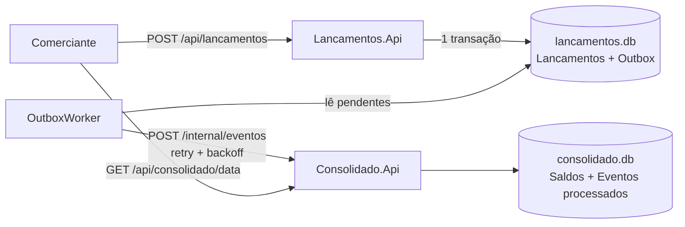

# Fluxo de Caixa

Solução para controle de fluxo de caixa de um comerciante: registro de lançamentos (créditos e débitos) e consulta do saldo diário consolidado.

São dois serviços independentes em .NET 10 / C#:

| Serviço | Porta | Responsabilidade |
|---|---|---|
| **Lancamentos.Api** | 5101 | Registrar e listar lançamentos. Emite o token de acesso (apenas para uso local). |
| **Consolidado.Api** | 5102 | Manter e consultar o saldo diário consolidado. |

O requisito central — *o controle de lançamentos não pode parar se o consolidado cair* — é resolvido com o **Transactional Outbox**: o lançamento e o evento são gravados na mesma transação local, e um worker entrega o evento ao consolidado em segundo plano, com retry e backoff. Se o consolidado estiver fora, os eventos ficam na fila (tabela) e são entregues quando ele voltar.



**Arquitetura adotada:** microsserviços enxutos (2 serviços), orientados a eventos, com CQRS entre escrita e leitura, banco por serviço e arquitetura em camadas (API → Application → Domain → Infrastructure) dentro de cada um. Resumo na [seção 0 de docs/arquitetura.md](docs/arquitetura.md).

A justificativa das decisões, os diagramas completos e a evolução prevista estão em [docs/](docs/):

- [docs/arquitetura.md](docs/arquitetura.md) — visão geral, domínios, fluxos, requisitos não funcionais, segurança
- [docs/adr/](docs/adr) — registros das decisões arquiteturais
- [docs/evolucao.md](docs/evolucao.md) — o que eu faria com mais tempo

## Como rodar

Pré-requisito: [.NET SDK 10](https://dotnet.microsoft.com/download). Não precisa de Docker nem de banco instalado (usa SQLite em arquivo).

```powershell
git clone <url-do-repositorio>
cd FluxoCaixa

# sobe os dois serviços (cada um numa janela)
.\scripts\run-local.ps1
```

Ou manualmente, em dois terminais:

```bash
dotnet run --project src/Consolidado.Api
dotnet run --project src/Lancamentos.Api
```

Com os dois no ar, o script de demonstração faz login, cria alguns lançamentos e mostra o consolidado:

```powershell
.\scripts\demo.ps1
```

Os bancos (`lancamentos.db` e `consolidado.db`) são criados sozinhos na primeira execução, dentro da pasta de cada projeto.

### Testando a resiliência

1. Com tudo rodando, feche a janela do **Consolidado**.
2. Continue registrando lançamentos — a API responde `201` normalmente.
3. Suba o Consolidado de novo. Em alguns segundos os eventos pendentes são entregues e o saldo do dia fica correto.

### Usando a API

O arquivo [requests.http](requests.http) tem exemplos prontos (extensão REST Client do VS Code). Em resumo:

```bash
# 1. token (usuário de desenvolvimento: comerciante / senha123)
curl -X POST http://localhost:5101/auth/token -H "Content-Type: application/json" \
     -d '{"usuario":"comerciante","senha":"senha123"}'

# 2. registrar lançamento (tipo: Credito | Debito)
curl -X POST http://localhost:5101/api/lancamentos \
     -H "Authorization: Bearer <token>" -H "Content-Type: application/json" \
     -d '{"tipo":"Credito","valor":250.00,"descricao":"Venda no balcão"}'

# 3. listar lançamentos do dia
curl "http://localhost:5101/api/lancamentos?data=2026-10-26" -H "Authorization: Bearer <token>"

# 4. consolidado do dia
curl http://localhost:5102/api/consolidado/2026-10-26 -H "Authorization: Bearer <token>"
```

| Método | Rota | Serviço | Auth |
|---|---|---|---|
| POST | `/auth/token` | Lancamentos | — |
| POST | `/api/lancamentos` | Lancamentos | JWT |
| GET | `/api/lancamentos?data=` | Lancamentos | JWT |
| GET | `/api/consolidado/{data}` | Consolidado | JWT |
| POST | `/internal/eventos` | Consolidado | API key (uso interno) |
| GET | `/health` | ambos | — |

Se `data` não for informada ao lançar, vale o dia atual no fuso `America/Sao_Paulo` (configurável em `Negocio:FusoHorario`).

## Relatório de atendimento aos requisitos técnicos obrigatórios

| Requisito | Status | O que foi feito e onde |
|---|---|---|
| **Desenho da solução** | Atendido | Diagramas Mermaid de contexto, componentes e sequência (registrar lançamento, consultar consolidado, idempotência) em [docs/arquitetura.md](docs/arquitetura.md); visão geral neste README; decisões registradas em [docs/adr/](docs/adr) (ADR-001 a 004) |
| **Feito em C#** | Atendido | .NET 10 / ASP.NET Core: [src/Lancamentos.Api](src/Lancamentos.Api) e [src/Consolidado.Api](src/Consolidado.Api), com EF Core |
| **Testes** | Atendido | 24 testes em [tests/](tests): unidade de domínio, unidade de serviço e integração de API (`WebApplicationFactory`), incluindo o cenário de queda do consolidado. Teste de carga k6 em [scripts/carga-consolidado.js](scripts/carga-consolidado.js) |
| **Boas práticas** | Atendido | Detalhado abaixo |
| **README com instruções** | Atendido | Seções "Como rodar", "Testando a resiliência" e "Usando a API" neste arquivo; [requests.http](requests.http) e [scripts/](scripts) para execução e demonstração |

### Padrões e boas práticas aplicados

| Prática | Onde |
|---|---|
| **Arquitetura em camadas** (Controllers → Application → Domain → Infrastructure) | Pastas de cada serviço em `src/` |
| **Transactional Outbox** | `OutboxMessage` ([Domain](src/Lancamentos.Api/Domain/OutboxMessage.cs)), gravada junto com o lançamento em `LancamentoService`; entrega por `OutboxWorker` ([Infrastructure/OutboxPublisher.cs](src/Lancamentos.Api/Infrastructure/OutboxPublisher.cs)) |
| **Retry com backoff exponencial** | `OutboxMessage.RegistrarFalha` |
| **Idempotent Consumer** | `EventoProcessado` e `ConsolidadoService` ([Consolidado.Api](src/Consolidado.Api)) |
| **CQRS** (escrita × leitura em serviços separados) | Lancamentos.Api × Consolidado.Api |
| **Cache-aside** | `ConsolidadoService.ConsultarAsync` com `IMemoryCache` |
| **Factory Method + invariantes no domínio** | `Lancamento.Criar` ([Domain/Lancamento.cs](src/Lancamentos.Api/Domain/Lancamento.cs)) |
| **Domain-driven (entidades com regras)** | `Lancamento`, `SaldoDiario`, `DominioException` |
| **Strategy / Dependency Inversion** | `IEventPublisher` → `HttpEventPublisher`; `TimeProvider` injetado |
| **Injeção de dependência** | `Program.cs` de cada serviço |
| **DTOs imutáveis** | `record` (`RegistrarLancamentoRequest`, `LancamentoResponse`, `SaldoDiarioResponse`, `LancamentoRegistradoEvent`) |
| **Health checks** | `/health` nos dois serviços |
| **Segurança** | JWT nos endpoints de negócio; API key (comparação em tempo constante) no endpoint interno `/internal/eventos` |

### SOLID

| Princípio | Aplicação |
|---|---|
| **S** — Responsabilidade única | Controller só traduz HTTP; `*Service` orquestra o caso de uso; entidade guarda as regras; `OutboxWorker` só entrega eventos |
| **O** — Aberto/fechado | Trocar HTTP por um broker é uma nova implementação de `IEventPublisher`, sem alterar serviço nem domínio |
| **L** — Substituição de Liskov | Qualquer `IEventPublisher` (HTTP, falso nos testes) é intercambiável |
| **I** — Segregação de interfaces | Interfaces pequenas e focadas: `IEventPublisher`, `ILancamentoService`, `IConsolidadoService` |
| **D** — Inversão de dependência | Serviços dependem de abstrações (`IEventPublisher`, `TimeProvider`), resolvidas na composição (`Program.cs`) |

## Testes

```bash
dotnet test
```

São 24 testes:

- **Domínio:** regras do lançamento (valor positivo, 2 casas decimais, descrição), backoff da outbox, soma do saldo.
- **Serviço de consolidado:** soma por dia, idempotência (evento repetido não duplica), cache sendo invalidado.
- **API (integração, com `WebApplicationFactory`):** autenticação, validações, e o cenário de queda do consolidado — lançamento aceito com o publisher falhando e evento entregue depois.

Teste de carga do requisito de 50 req/s (precisa do [k6](https://k6.io)):

```bash
k6 run -e TOKEN=<jwt> scripts/carga-consolidado.js
```

## Estrutura

```
src/
  Lancamentos.Api/     Domain · Application · Infrastructure · Controllers
  Consolidado.Api/     Domain · Application · Infrastructure · Controllers
tests/
  Lancamentos.Tests/
  Consolidado.Tests/
docs/                  arquitetura, ADRs, evolução
scripts/               run-local, demo, teste de carga
```

## Limitações conhecidas (e por quê)

Algumas escolhas foram para o projeto rodar com um `dotnet run` e nada mais. Estão listadas com o caminho de produção em [docs/evolucao.md](docs/evolucao.md): SQLite no lugar de um banco de servidor, HTTP no lugar de um broker (RabbitMQ/Kafka), emissão de token dentro da própria API e `EnsureCreated` no lugar de migrations.
