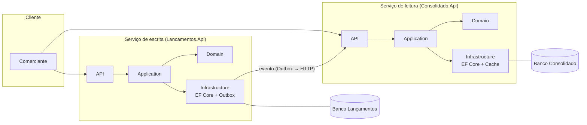
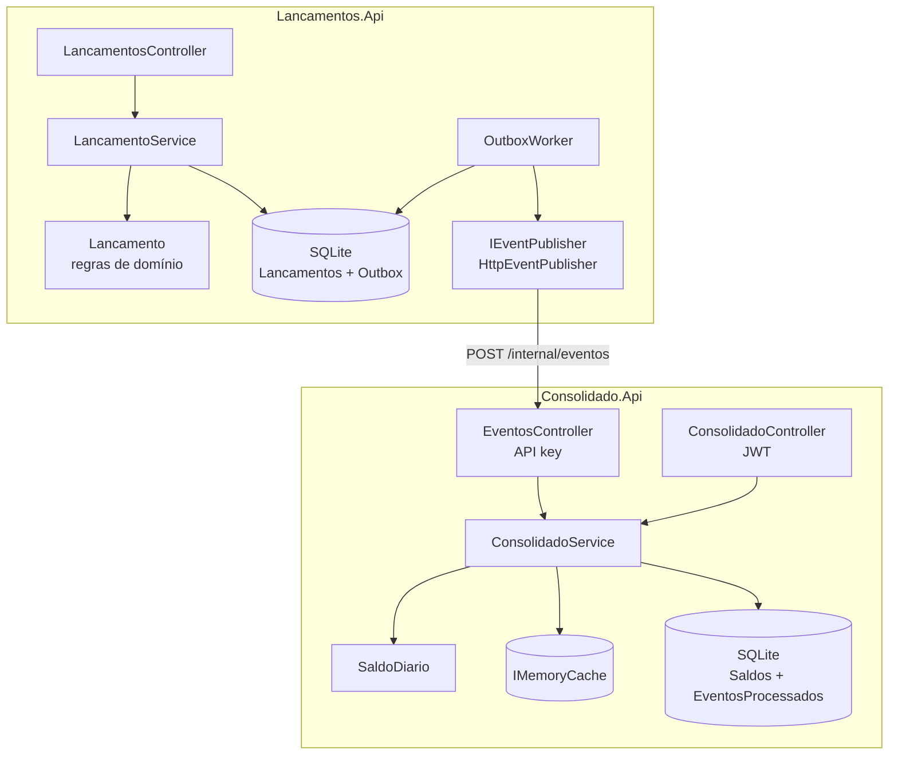
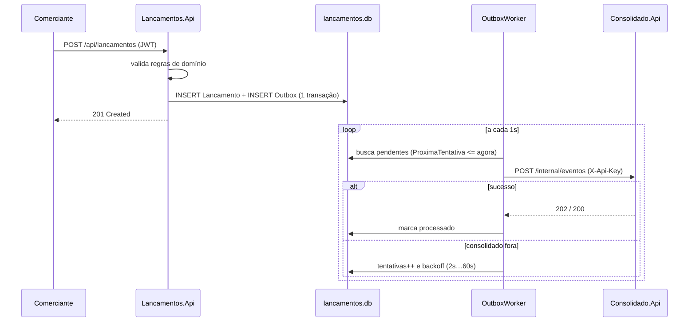
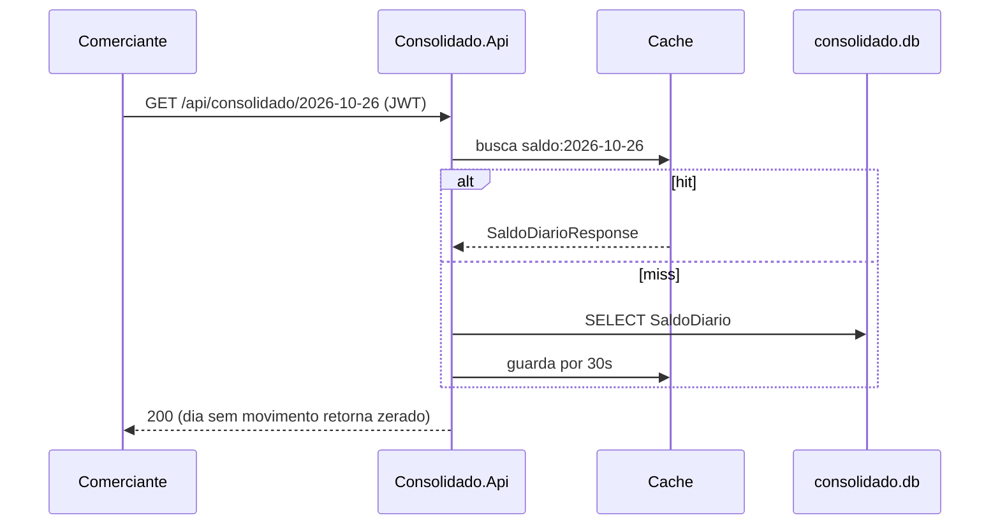

# Arquitetura

## 0. Arquitetura adotada (resumo)

| Nível | Escolha |
|---|---|
| **Estilo geral** | **Microsserviços enxutos** (2 serviços), orientados a eventos, com consistência eventual entre eles |
| **Separação leitura/escrita** | **CQRS** em nível de serviço: Lançamentos (escrita, fonte da verdade) e Consolidado (leitura, projeção) |
| **Comunicação** | Assíncrona por eventos (`LancamentoRegistrado`), entregues via **Transactional Outbox**; hoje sobre HTTP, com broker previsto (ADR-003) |
| **Estrutura interna de cada serviço** | **Arquitetura em camadas**: `Controllers (API) → Application (casos de uso) → Domain (regras)`, com `Infrastructure` (EF Core, HTTP, outbox) isolada por interfaces |
| **Dados** | *Database per service*: cada serviço tem seu banco, sem acesso cruzado (SQLite local; PostgreSQL/SQL Server em produção) |
| **Hospedagem** | Aplicações ASP.NET Core stateless, escaláveis horizontalmente atrás de balanceador |
| **Segurança** | JWT nos endpoints de negócio; API key no endpoint interno entre serviços |

Não é um monolito (não isolaria a falha do consolidado), nem SOA com barramento central, nem serverless (ver seção 6). Também não é Clean/Hexagonal com um projeto por camada: as camadas existem como pastas dentro de cada serviço, porque o domínio é pequeno (ver seção 2).

## 1. Contexto e requisitos

Um comerciante precisa lançar créditos e débitos do dia a dia e consultar o saldo diário consolidado.

**Funcionais**
- Serviço de controle de lançamentos.
- Serviço de consolidado diário.

**Não funcionais (do enunciado)**
- O serviço de lançamentos **não pode ficar indisponível** se o consolidado cair.
- Em pico, o consolidado recebe **50 req/s**, com no máximo **5% de perda**.

**Metas que defini para o projeto**

| Métrica | Meta |
|---|---|
| Disponibilidade de lançamentos | 99,9%, independente do consolidado |
| Latência de escrita de lançamento (p95) | < 200 ms |
| Latência de consulta do consolidado (p95) | < 100 ms (cache) |
| Taxa de erro do consolidado em 50 req/s | < 5% (a meta real é ~0%) |
| Atraso entre lançar e aparecer no consolidado | segundos em operação normal; sem perda após queda |

## 2. Domínios e decomposição

Separei em dois bounded contexts, porque têm ritmos e perfis de carga diferentes:

- **Lançamentos** — escrita, fonte da verdade. Cada lançamento é um fato imutável.
- **Consolidado** — leitura, uma *projeção* dos lançamentos agregada por dia. Pode ser reconstruída a partir dos eventos.

Cada serviço tem **seu próprio banco**. Nenhum lê a base do outro; só se falam por eventos.

Dentro de cada serviço, as camadas são `Controllers → Application → Domain`, com `Infrastructure` (EF Core, HTTP) atrás de interfaces onde isso faz diferença (`IEventPublisher`, `ILancamentoService`, `IConsolidadoService`). Optei por pastas em um único projeto por serviço em vez de um projeto por camada: o domínio é pequeno e separar em 4 assemblies por serviço seria cerimônia sem ganho.

## 3. Fluxos

### 3.1 Registrar lançamento

O usuário recebe a resposta depois da gravação local — ele **nunca espera** nem depende do consolidado.

### 3.2 Consultar consolidado

### 3.3 Aplicar evento (idempotência)

Entrega é "pelo menos uma vez" (o worker pode reenviar se perder a resposta). Por isso o consolidado grava o `EventoId` numa tabela e ignora repetidos, na mesma transação que altera o saldo. Como a operação é uma soma, a **ordem de chegada não importa**. Ao aplicar, o cache daquele dia é invalidado.

## 4. Requisitos não funcionais — como são atendidos

### Resiliência
- **Isolamento de falha:** lançamentos só depende do próprio banco para responder. Consolidado fora = eventos acumulam na outbox. Validado manualmente (derrubando o processo) e por teste automatizado.
- **Retry com backoff exponencial** (2s → 60s) e, se o consolidado falha, o lote é interrompido para não martelar um serviço doente.
- **Sem perda:** o evento é persistido junto com o lançamento; só sai da fila após confirmação.
- **Health checks** em `/health` nos dois serviços, prontos para probes de orquestrador.
- **Recuperação:** como o consolidado é uma projeção, na pior hipótese ele pode ser reconstruído reprocessando lançamentos.

### Escalabilidade e o requisito de 50 req/s
- A consulta de consolidado é uma leitura por chave primária (`Data`), com **cache em memória de 30 s** invalidado a cada evento aplicado. Em pico, quase todas as 50 req/s são servidas do cache sem tocar no banco.
- Os serviços são *stateless* (exceto o cache local), então escalam horizontalmente atrás de um balanceador. Com várias réplicas, o cache passaria a ser distribuído (Redis) — ver evolução.
- Leitura e escrita já estão separadas em serviços diferentes (CQRS na prática), podendo ser dimensionadas de forma independente.
- Há um script k6 em `scripts/carga-consolidado.js` com a meta de 50 req/s e threshold de falha < 5%.

### Segurança
- **Autenticação:** JWT (HS256) validando emissor, audiência, expiração e assinatura nos endpoints de negócio.
- **Chamada entre serviços:** endpoint interno protegido por API key, comparada em tempo constante (`FixedTimeEquals`). Não há usuário nesse fluxo, então JWT de usuário não faria sentido.
- **Validação** de todas as entradas no domínio; erros de negócio retornam 400 sem vazar stack trace.
- **Segredos:** as chaves em `appsettings.json` são só de desenvolvimento; em produção vêm de variável de ambiente / cofre.
- **Em produção:** HTTPS/TLS terminado no gateway, rate limiting, e um IdP de verdade (ver evolução).

### Integridade dos dados
- Valores em `decimal` (nunca `double`), com validação de 2 casas.
- Lançamento + evento na mesma transação (outbox).
- Idempotência por `EventoId`.
- Escritas no saldo serializadas por lock no processo (necessário no SQLite; num banco servidor vira `UPDATE` atômico).
- O "dia" do lançamento segue o fuso do negócio (`America/Sao_Paulo`), não UTC.

## 5. Padrões utilizados

| Padrão | Onde |
|---|---|
| Transactional Outbox | `Outbox` + `OutboxWorker` |
| Event-driven / mensageria assíncrona | comunicação entre os serviços |
| Idempotent Consumer | `EventosProcessados` |
| CQRS (separação leitura/escrita por serviço) | Lançamentos × Consolidado |
| Cache-aside | `ConsolidadoService.ConsultarAsync` |
| Factory method + invariantes no domínio | `Lancamento.Criar` |
| Dependency Inversion / Strategy | `IEventPublisher`, `TimeProvider` |
| Retry com backoff exponencial | `OutboxMessage.RegistrarFalha` |

SOLID aparece principalmente em: responsabilidade única (controller só traduz HTTP, service orquestra, entidade guarda as regras), inversão de dependência (transporte atrás de `IEventPublisher`) e aberto/fechado (trocar HTTP por broker não altera serviço nem domínio).

## 6. Por que não microsserviços "completos", monolito ou serverless?

Fiquei com **dois serviços** porque o enunciado exige que um possa cair sem derrubar o outro — isso é a fronteira natural. Um monolito não daria o isolamento de falha; quebrar além disso (ex.: serviço de autenticação, de relatórios) seria complexidade operacional sem necessidade para este escopo. Serverless funcionaria bem para o consolidado (carga em picos), mas aumentaria o acoplamento com um provedor específico. Detalhes em [ADR-001](adr/001-dois-servicos-com-bancos-proprios.md).
